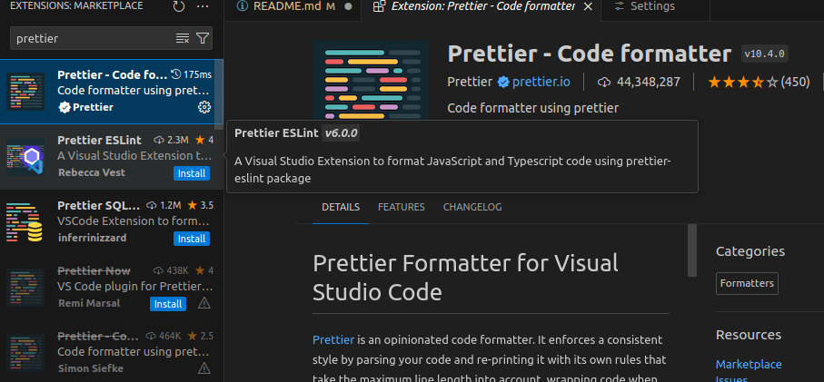
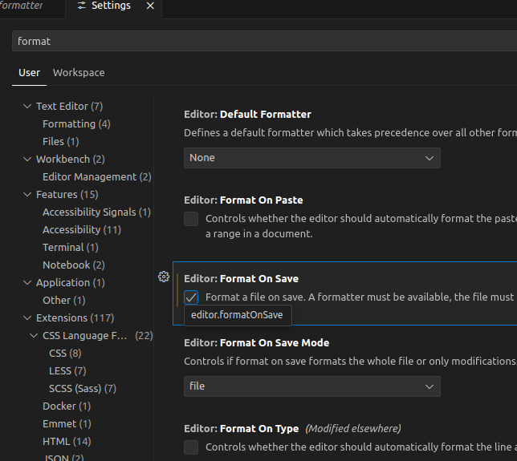

# simple-todo-react-app

[](https://github.com/ckroeger/simple-todo-react-app/actions/workflows/test.yml)
[](https://codecov.io/gh/ckroeger/simple-todo-react-app)

A simple TODO-APP developt in React


## Prequisites

- Node 18 or above
- React 18 or above
- Vite
- TypeScript

## Functional Requirements

- list todos
- create a todo
- delete a todo
- mark todo as done
- move todo up
- move todo down

## Commands

```shell
npm install
npm run dev
```

## Running Unit Tests

This project uses [Vitest](https://vitest.dev/) and [React Testing Library](https://testing-library.com/docs/react-testing-library/intro/) for unit testing React components.

### To run all tests:

```shell
npm test
# or
npx vitest
```

### To run tests with UI (optional):

```shell
npx vitest --ui
```

### Notes

- Test files are located alongside components and use the `.test.tsx` extension (e.g., `src/ToDoList.test.tsx`).
- Ensure you have installed all dev dependencies with `npm install` before running tests.

# Tasks

## Task #1 - create a ToDoList Compnent

- create a ToDoList Compnent
  - Functions:
    - add todo
    - delete todo
    - move todo up
    - move todo down
  - Styling
    - add css

## Task #2 - create a github-action to deploy app

- ☑️ create a github-action to publish the app on a github-page

## VSCode Plugins

### Prettier

Install Prettier


##### Configure Prettier


